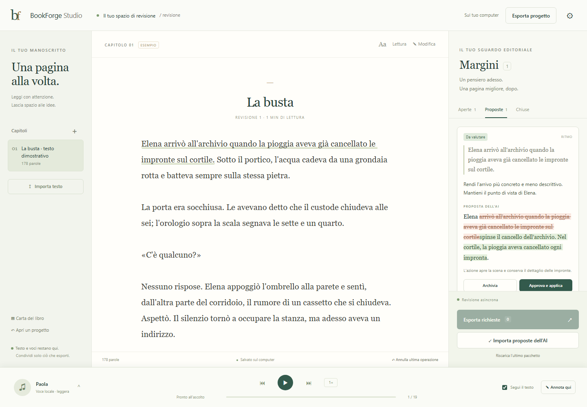
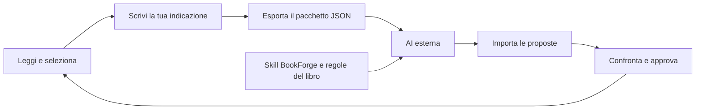
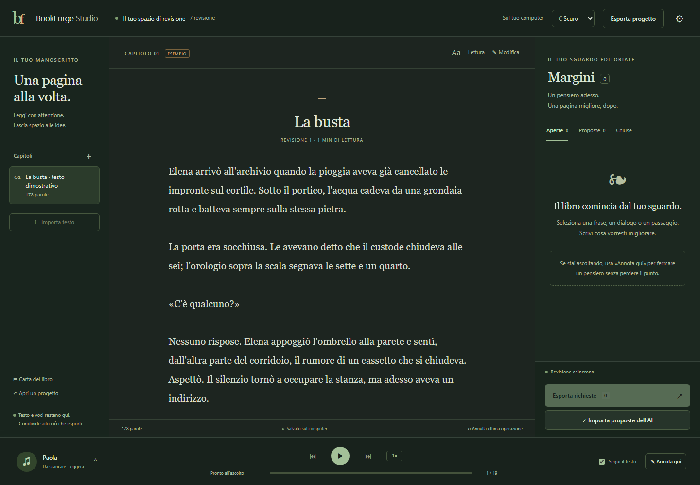

<p align="center">
  
</p>

<h1 align="center">BookForge Studio</h1>

<p align="center"><strong>Leggi. Ascolta. Annota. Decidi.</strong></p>
<p align="center">Una dashboard locale per supervisionare e migliorare il testo scritto con l’AI.</p>

<p align="center">
  <a href="#avvio-rapido">Avvio rapido</a> ·
  <a href="#come-funziona-la-revisione">Flusso di revisione</a> ·
  <a href="#bookforge-e-bookforge-studio">Sinergia con BookForge</a> ·
  <a href="LEGGIMI.md">Guida completa</a>
</p>



*Interfaccia reale con un testo dimostrativo: il manoscritto resta al centro, mentre richieste e proposte si consultano nei margini.*

## Perché questo progetto

Quando si scrive un libro con un assistente AI, il lavoro dell’autore continua dopo la generazione: leggere con attenzione, riconoscere una frase che non funziona, ascoltare il ritmo, spiegare cosa cambiare e scegliere quali proposte accettare.

BookForge Studio organizza questo lavoro in un unico spazio. Selezioni un passaggio, lasci un’indicazione e lo affidi alla revisione. L’AI elabora le proposte esternamente; nell’app puoi confrontarle con l’originale e approvarle una per una.

Il progetto esplora un modo concreto di sviluppare strumenti AI centrati sulla supervisione umana: interfaccia di lettura, istruzioni editoriali, scambio strutturato dei dati, controlli sulle versioni e sintesi vocale locale.

## BookForge e BookForge Studio

I due progetti affrontano parti complementari dello stesso processo editoriale.

| Progetto | Che cos’è | Il suo ruolo |
|---|---|---|
| **[BookForge](https://github.com/Simus100/BookForge)** | Una skill di scrittura: istruzioni e competenze editoriali per un assistente AI compatibile | Guidare progettazione, stesura e revisione, preservando intenzione dell’autore, voce, personaggi e continuità |
| **BookForge Studio** | Una dashboard di lettura, ascolto ed editing del manoscritto | Rendere semplici selezione dei brani, annotazione, scambio delle revisioni e approvazione delle modifiche |

**BookForge fornisce il metodo editoriale all’AI; Studio offre all’autore uno spazio per supervisionare il testo.**

Puoi usare BookForge nell’assistente esterno che revisiona il libro e riportare nella **Carta del libro** di Studio le regole pertinenti: voce, punto di vista, fatti di canone e vincoli. Queste indicazioni accompagnano i pacchetti esportati.

La collaborazione fra i due progetti avviene tramite istruzioni e file. Studio non carica automaticamente l’intera skill e non condivide uno stato di progetto nativo con BookForge. Può essere usato anche da solo, con l’AI scelta dall’autore.

## Funzionalità

### Leggere ed editare

- **Manoscritto al centro**, con navigazione per capitoli e pannelli laterali richiudibili.
- **Importazione TXT e Markdown** come testo semplice, creazione di nuovi capitoli e modifica manuale.
- **Selezione di un brano e annotazione contestuale**: spiega cosa migliorare e cosa preservare.
- **Richieste organizzate** per voce, ritmo, dialoghi, continuità, chiarezza, refusi o revisione libera.
- **Carta del libro** con indicazioni editoriali condivise nelle esportazioni.
- **Tema chiaro e scuro**, con preferenza conservata nel browser, e dimensione del testo regolabile.

### Supervisionare le proposte

- **Esportazione delle richieste in JSON** con originale, commento, contesto, identificativi e formato di risposta.
- **Importazione delle riscritture** restituite da un’AI esterna, da file o incollando il JSON.
- **Confronto visivo** delle parti rimosse e aggiunte, con motivazione dell’intervento.
- **Approvazione esplicita** prima di sostituire il testo; possibilità di archiviare una richiesta.
- **Controllo dei conflitti** se il brano cambia o un altro intervento modifica una selezione sovrapposta.
- **Importazioni ripetibili senza duplicazioni**, annullamento dell’ultima operazione e backup del progetto.

### Ascoltare il testo

- **Sintesi vocale sul computer**, con modelli scaricabili e audio conservato localmente.
- **Evidenziazione della frase in ascolto** collegata al segmento audio effettivamente riprodotto.
- **Pausa, ripresa, frase precedente e successiva**, velocità e scorrimento automatico disattivabile.
- **Annota qui** per fermare la lettura e lasciare una richiesta sulla frase corrente.
- **Preparazione anticipata e cache dell’audio**, con modelli mantenuti in memoria durante l’uso.
- **Scelta automatica fra le voci installate** sulla base delle prestazioni misurate.

## Come funziona la revisione



1. **Leggi o ascolta** il capitolo e seleziona il passaggio da rivedere.
2. **Aggiungi la tua richiesta**, per esempio: «Rendi il dialogo meno esplicativo, mantenendo la voce del personaggio».
3. **Esporta le richieste**. Il file include anche i capitoli interessati per fornire contesto all’AI.
4. **Allega il pacchetto all’assistente che preferisci**, usando eventualmente la skill [BookForge](https://github.com/Simus100/BookForge). Puoi continuare a leggere mentre la revisione viene svolta.
5. **Importa la risposta strutturata**. Le proposte compaiono accanto alle tue annotazioni.
6. **Confronta, approva oppure archivia**. L’importazione, da sola, non modifica il manoscritto.

### Il significato di “deterministico”

La riscrittura rimane un lavoro generativo dell’AI esterna. Studio gestisce in modo strutturato l’esportazione e l’applicazione: verifica libro, pacchetto, richiesta e testo originale, quindi applica esattamente la sostituzione approvata.

Se hai cambiato il brano nel frattempo, oppure due interventi si sovrappongono, la sostituzione viene bloccata e segnalata. L’app non risolve il conflitto inventando una nuova versione del testo.

Il pacchetto contiene un modello di risposta e un JSON Schema. I formati sono `bookforge.requests.v1` e `bookforge.responses.v1`.

## Due modi di leggere



*Il tema scuro si applica a manoscritto, annotazioni, moduli di modifica e lettore vocale. Puoi tornare al tema chiaro dal selettore in alto a destra.*

## Voci locali e prestazioni

| Profilo | Motore | Impiego previsto | Stato |
|---|---|---|---|
| **Leggera · Paola** | Piper, italiano medium | Lettura su CPU, senza GPU dedicata | Sintesi e riproduzione verificate |
| **Essenziale · Riccardo** | Piper, italiano x_low | Modello più piccolo per macchine meno potenti | Sintesi e riproduzione verificate |
| **Studio · Narratore** | Qwen3-TTS 1.7B CustomVoice | Narrazione generativa con GPU NVIDIA/CUDA compatibile | Integrazione presente; collaudo GPU ancora da effettuare |

Le voci si scaricano dalle impostazioni di ascolto. Dopo l’installazione, la sintesi avviene localmente senza un servizio TTS cloud. Il download dei modelli e l’installazione delle dipendenze richiedono Internet.

L’installazione di Studio è facoltativa e può richiedere diversi GB. Verifica la GPU ed esegue una breve sintesi locale prima di rendere il modello selezionabile. Naturalezza, accento italiano e fluidità vanno provati sul proprio manoscritto e hardware.

L’audio viene generato per frase, così l’evidenziazione segue il testo pronunciato. Il primo caricamento è più lento; le frasi successive riutilizzano il modello. Questo approccio è pensato per la revisione e non offre ancora la continuità prosodica di una produzione per paragrafi con allineamento fonetico.

## Avvio rapido

**Requisiti:** Python **3.12**, un browser moderno e spazio su disco per le voci. Il percorso principale è stato collaudato su **Windows x64**.

```bash
git clone https://github.com/Simus100/bookforge-studio.git
cd bookforge-studio
python bootstrap.py
```

Su Windows puoi anche aprire **`Avvia.cmd`**. Il bootstrap prepara un ambiente Python isolato e avvia l’interfaccia nel browser. Da lì puoi importare il testo e scaricare la voce desiderata.

Il repository distribuisce i sorgenti: modelli vocali e ambienti Python non sono inclusi.

- **`Arresta.cmd`** ferma il servizio locale.
- **`Spazio`** mette in pausa o riprende la lettura.
- **`N`** durante l’ascolto apre una nota sulla frase corrente.
- La [guida completa](LEGGIMI.md) descrive scambio dei file, backup e recupero.

Puoi avviare il solo server, per esempio per sviluppo o per lavorare sul testo senza installare ancora il TTS:

```bash
python server.py --open
```

Il server ascolta su `127.0.0.1` e apre una porta locale. Non richiede un deployment web.

## Dati e indipendenza dall’assistente AI

Studio non include un modello di scrittura né una chat con un fornitore AI. Il suo funzionamento editoriale non richiede una chiave API: usi l’assistente esterno nella sua applicazione, secondo il piano di accesso di quel servizio.

Il manoscritto, le annotazioni, i modelli vocali e l’audio restano sul computer. Il testo viene condiviso con un’altra AI quando sei tu a passarle il pacchetto esportato. Il pacchetto include il contenuto dei capitoli interessati, non soltanto la selezione.

Il salvataggio usa SQLite con transazioni e storico delle operazioni. Puoi esportare il progetto completo in JSON e ripristinarlo. Il repository esclude dati di lavoro, backup, audio, pesi dei modelli, ambienti Python e configurazioni locali.

## Struttura tecnica

| Parte | Implementazione |
|---|---|
| Interfaccia | HTML, CSS e JavaScript, senza framework o build frontend |
| Riproduzione | Web Audio API, segmenti preparati in anticipo e cache |
| Servizio locale | Python e `ThreadingHTTPServer` |
| Manoscritto e revisioni | SQLite, versioni del progetto e intervalli di testo |
| Protocollo di scambio | JSON versionato con modello di risposta e JSON Schema |
| TTS su CPU | Piper e ONNX Runtime |
| TTS su GPU, opzionale | Worker Qwen3-TTS con ambiente separato |

```text
web/                 Interfaccia, temi e player
core.py              Progetto e protocollo di revisione
server.py            Servizio HTTP locale
tts.py               Voci, download, cache e misure delle prestazioni
studio_worker.py     Worker del profilo GPU
bootstrap.py         Preparazione dell’ambiente e avvio
tests/               Test del protocollo e del servizio HTTP
docs/screenshots/    Screenshot dimostrativi
```

## Verifiche e stato del progetto

La prima versione comprende **19 test automatici** per protocollo di revisione, persistenza, Unicode, sovrapposizioni, ripristino e controlli HTTP.

```bash
python -m unittest discover -s tests -v
```

Il flusso dell’interfaccia è stato collaudato in Chromium: selezione, annotazione, esportazione, importazione, confronto, approvazione e annullamento. Sono stati controllati anche la lettura Piper, l’evidenziazione, la pausa, i temi e i layout a 1440, 900 e 390 pixel. Dettagli e limiti sono nel [resoconto di verifica](VERIFICA.md).

**Stato: prima versione funzionante.** L’app importa testo semplice; non gestisce ancora DOCX, EPUB, immagini o impaginazione complessa. Non è un installer desktop firmato. Il confronto evidenzia l’intervallo cambiato fra prefisso e suffisso comuni, non ogni modifica interna come farebbe un motore diff avanzato. Il profilo GPU e l’esperienza su un intero libro richiedono ulteriori prove.

## Portfolio e progetti collegati

BookForge Studio fa parte del **portfolio di sviluppo AI di [Simone Macelloni](https://github.com/Simus100)**. Il progetto è stato sviluppato con assistenza AI, guidando le scelte di prodotto, il flusso editoriale e le verifiche tecniche.

Il suo contributo al portfolio è l’integrazione fra un’interfaccia centrata sulla lettura, il controllo umano sulle revisioni, un protocollo indipendente dal fornitore AI e modelli vocali eseguiti localmente.

→ **[Scopri BookForge, la skill di scrittura complementare](https://github.com/Simus100/BookForge)**

## Componenti e licenze

**Copyright © 2026 Simone Macelloni. Tutti i diritti riservati.** Vedi [LICENSE](LICENSE) per l’avviso relativo ai contenuti originali del progetto. La pubblicazione dei sorgenti non introduce una licenza open source o un’autorizzazione generale al riutilizzo commerciale.

Piper, le voci e Qwen3-TTS mantengono i rispettivi titolari e le proprie licenze: vedi [TERZE_PARTI.md](TERZE_PARTI.md). Modelli e dipendenze vengono installati separatamente.
